<p align="center">
  <a href="https://huggingface.co/spaces/Agnuxo/terra-compute-game"></a>
  
  
  
  
</p>

---

## What is TERRA COMPUTE?

**TERRA COMPUTE: Race to ASI** is a browser-based grand strategy game where you lead a continent through the most transformative era in human history — from the Cold War of **1960** to the brink of the **Singularity in 2035**. Build infrastructure, research breakthrough technologies, manage resources, outmaneuver rival AI superpowers, and race to become the first nation to achieve **Artificial Superintelligence**.

Every decision matters. Every building changes the trajectory of history. Will you focus on economic dominance, scientific supremacy, or brute military force? The path to ASI is yours to forge.

---

## How to Play

### The goal
Reach **1 YottaFLOP (10²⁴ FLOPS)**, research **Superintelligence Theory**, and press **IGNITE** with **alignment ≥ 80%** — before any rival does, and without letting **planet health** fall to 0%.

You lose if:
- a rival ignites a safe superintelligence first (**race lost**),
- anyone — you or a rival — ignites an **unaligned** one (**rogue ASI**),
- global warming drives planet health to 0% (**planetary collapse**),
- approval stays under 20% for 3 years (**revolution**), or debt spirals for 3 years (**bankruptcy**),
- nobody ignites before **2040** (**window closed**).

### 1. Select your game mode

| Mode | Start | Description |
|------|-------|-------------|
| **PIONEER** | 1960 | Learn every system. Rivals never ignite, no defeat states. Goal: 10²² FLOPS, 70% alignment. |
| **ESTRATEGA** | 1980 | Start with an industrial base. Seven active rivals, full rules. |
| **COMPLETO** | 1960 | The full campaign. Unlocked by winning Pioneer or Estratega. |
| **LOGIC** | — | Replay the 8 breakthrough exercises at 3 difficulty levels. |

### 2. Choose your faction — every bonus is real

| Faction | Bonus |
|---------|-------|
| North America | +25% research |
| Europe | Techs −15% cost, +4 approval |
| Soviet Union | +30% industry, extra coal & uranium deposits |
| China | −25% construction time, +20% kombinats |
| Africa | +60% solar, cheaper land development |
| South America | +25% farms & solar, forests absorb 2× CO₂ |
| India | Education grows 40% faster, +15% research |
| Oceania | Enemy operations −40%, +20% nuclear, rich uranium |

### 3. Build your continent (the central map)
Your continent is generated from its real outline as an isometric tile map with **terrain** (plains, river valleys, forest, hills, desert, tundra, coast), **mineral deposits** (coal, uranium, silica) and **regions**. Only developed regions can be built on — click a dark region to **DEVELOP** it.

- Click an empty tile to see what fits there, sorted by its **location multiplier**.
- Or choose a building in **BUILD [B]**: the map lights up green/amber/red with the bonus of every tile. *Shift+click* places several.
- Click a building to see its output and **adjacency bonuses**, **UPGRADE** it (levels 1–3) or **DEMOLISH** it.

Examples of placement rules: farms +50% on river valleys and +10% per neighbouring farm; solar +60% on desert; nuclear needs coast or river; seaports need coast; institutes +20% per neighbouring university; compute buildings cool for free on tundra or coast; smoke from coal and kombinats makes nearby homes unhappy.

### 4. Keep the nation alive
Hover any gauge in the top bar for the full breakdown.

| Gauge | What drives it |
|-------|----------------|
| **Budget** | GDP × tax rate + trade treaties − building upkeep. Tax slider inside the gauge. |
| **Food / Housing** | Farms and housing blocks. Shortages shrink the population and crush approval. |
| **Jobs** | Kombinats, markets and ports create jobs; robots fill labour shortages. |
| **Power** | Coal, nuclear, solar, fusion. Below 100% everything runs slower. Pre-1960 plants slowly retire. |
| **Education** | Schools lift it to ~75, universities towards 100. Multiplies GDP and research. |
| **Research** | Institutes, universities, space centres — and, after Deep Learning, compute itself. |
| **Compute** | Mainframe → Supercomputer → Data Center → GPU Cluster → AI Gigafactory, × technology multipliers. |
| **Approval** | Food, homes, jobs, healthcare, neighbourhoods, taxes, power cuts, climate damage, events. |
| **Alignment** | AI Safety Institutes raise it; capability pressure lowers it. Safety research raises its ceiling. |

### Industry, market and decrees
- **Steel** comes from Industrial Kombinats, **chips** from Chip Foundries (+50% on silica). Advanced buildings cost steel and chips, and compute buildings burn chips every year to keep their hardware running.
- Anything you lack is **imported** automatically at world-market prices — convenient, but expensive. Prices move when you trade a lot and follow history (chips are precious in the 1960s, cheap in the 2000s, scarce again in the AI boom).
- **ECONOMY [E]** opens the decree board and the world market. Decrees (Five-Year Plan, Free Market, Welfare State, Austerity, Autarky, Open Trade, Green Deal, Space Race, Security State, Ministry of Truth, Manhattan Project for AI, Safety First…) each have a clear benefit and a clear price, some exclude each other, slots grow with each era, and every change reshuffles the government for two years.

### The command map
An animated isometric view in the spirit of classic RTS games: an automatic road network with traffic, smoking chimneys and cooling towers, a radioactive glow over nuclear plants, plasma in fusion reactors, data beams over AI datacenters, rocket launches from space centres, ships in the ports, a day–night cycle and smog that thickens as the planet suffers. A clickable sector map (minimap) shows the whole continent; arrows, screen edges, drag and mouse wheel move the camera.

### 5. Research
30 technologies in 5 eras, with prerequisites. You may research up to 10 years ahead of history, at +10% cost per year early.

### 6. The world
- **Rivals** race along their own compute curves. Without intelligence you only see rough estimates.
- **Diplomacy [D]**: aid raises relations; treaties need minimum relations — *Trade*, *Research Pact*, *Climate Accord* (cuts their emissions), *AI Safety Treaty* (makes them safer and slower).
- **Spy [S] / Covert [A]**: intelligence sweeps, research theft, cyber-sabotage, propaganda. Getting caught costs relations.
- **Planet**: every bloc's emissions heat the world. Low planet health brings droughts, floods and heatwaves.

### 7. History happens
Around 30 historical events (oil crisis, AI winters, dot-com crash, COVID, ChatGPT…) arrive as **decisions with trade-offs**. Eight AI milestones open a **breakthrough exercise**: a short minigame whose stars grant research and bonuses. Exercises can always be skipped.

| Exercise | Milestone | Game |
|----------|-----------|------|
| Bombe Codebreaker | Turing | Mastermind-style logic on 4 rotors |
| Perceptron Trainer | Rosenblatt, 1957 | Tune weights and bias to separate two classes |
| LISP Pipeline | McCarthy, 1958 | Compose list functions to reach a target |
| Samuel's Checkers | Samuel, 1959 | Find the longest multi-jump |
| Integrated Circuit Router | Moore, 1965 | Rotate circuit tiles to power every chip |
| Deep Blue | 1997 | Mate-in-1 and mate-in-2 chess puzzles |
| Atari Go vs Proto-AlphaGo | 2016 | First capture wins |
| Attention Is All You Need | 2017 | Find what each pronoun refers to |

### Controls
`B` build · `T` tech · `D` diplomacy · `S` spy · `A` covert · `E` economy · `M` continent/world view · `Space` pause · `1–3` speed · `Esc` cancel / game menu · arrows, screen edge, drag and mouse wheel move the camera · `Home` fits the map · double-click focuses a tile.

### A complete game
Interactive tutorial, three difficulty levels (easy / normal / hard), save games in three slots plus autosave, settings (volume, scrolling, day–night, reduced motion), 15 achievements and an end-of-game report with charts of your whole run.

---

## Action Cards

| Card | Action | Key | Description |
|------|--------|-----|-------------|
| 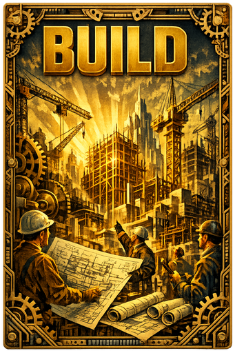 | **BUILD** | B | Construction menu and placement on the map |
| 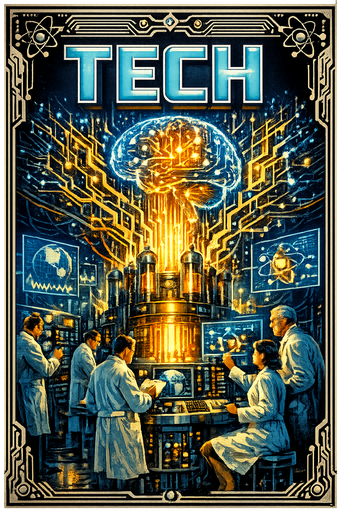 | **TECH** | T | Research tree |
| 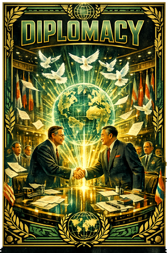 | **DIPLOMACY** | D | Aid and treaties |
| 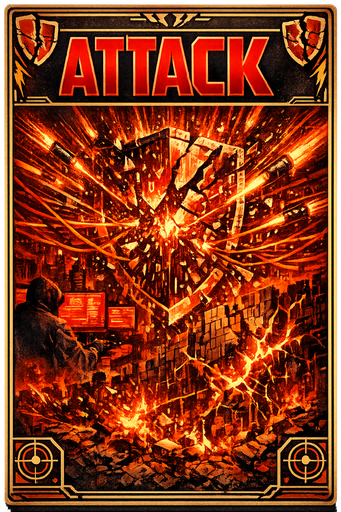 | **ATTACK** | A | Sabotage and propaganda |
| 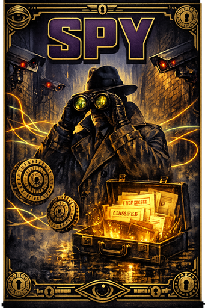 | **SPY** | S | Intelligence and research theft |
| 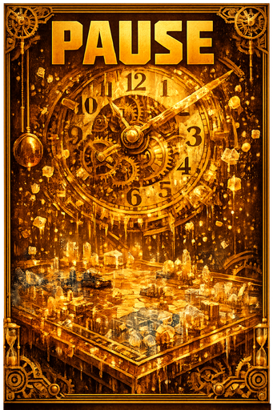 | **PAUSE** | Space | Pause or resume |

---

## Historical Event Cards

Throughout your journey, **historical events** will reshape the world. Each event comes with a cinematic video and gameplay consequences.

### AI Milestones

| Year | Event | Effect |
|------|-------|--------|
| 1950 | **Turing Test** | The foundation of AI thinking |
| 1956 | **Dartmouth Workshop** | AI officially named and born |
| 1958 | **Perceptron** | First neural network |
| 1965 | **Moore's Law** | Computing power doubles every 2 years |
| 1966 | **ELIZA** | First conversational AI |
| 1974 | **First AI Winter** | Funding cuts, skepticism |
| 1980 | **Expert Systems** | AI enters business |
| 1986 | **Autonomous Vehicles** | Self-driving research begins |
| 1997 | **Deep Blue** | AI defeats world chess champion |
| 2011 | **IBM Watson** | AI wins Jeopardy! |
| 2012 | **AlexNet** | Deep learning revolution |
| 2016 | **AlphaGo** | AI masters Go |
| 2017 | **Transformers** | The architecture that changed everything |
| 2020 | **GPT-3** | Large language models emerge |
| 2022 | **ChatGPT** | AI goes mainstream |
| 2023 | **Multimodal AI** | AI sees, hears, and understands |
| 2024 | **AI Agents** | Autonomous AI systems |
| 2025 | **Agentic AI** | AI that acts on its own |
| 2027 | **Beyond Moore** | Quantum-classical hybrid computing |

### World Events

| Year | Event | Effect |
|------|-------|--------|
| 1973 | **Oil Crisis** | Energy costs spike, GDP drops |
| 1991 | **End of Cold War** | New tech sharing opportunities |
| 2001 | **Dot-Com Crash** | Tech sector turmoil |
| 2001 | **September 11** | Defense spending increases |
| 2001 | **China Joins WTO** | Manufacturing shifts east |
| 2008 | **Financial Crisis** | Global recession |
| 2020 | **COVID-19 Pandemic** | Remote work boom, AI acceleration |
| 2022 | **War in Ukraine** | Energy crisis, chip shortage |
| 2023 | **Chip War** | Semiconductor race intensifies |
| 2023 | **AI Boom** | Massive investment in AI |

---

## Faction Cards

Each continent has a unique propaganda-style card with special bonuses:

| Faction | Card | Special Bonus |
|---------|------|---------------|
| **North America** | 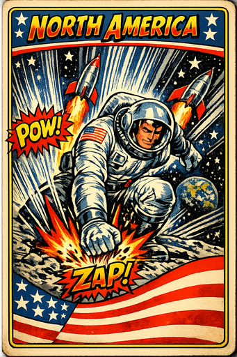 | +30% Research Speed |
| **Europe** | 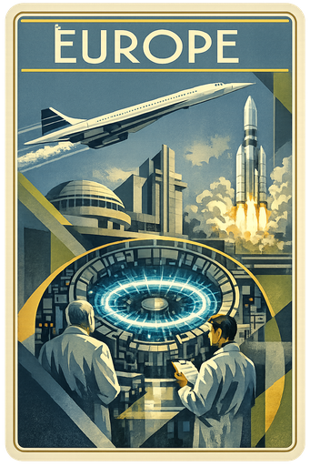 | +20% Tech Transfer |
| **Soviet Union** | 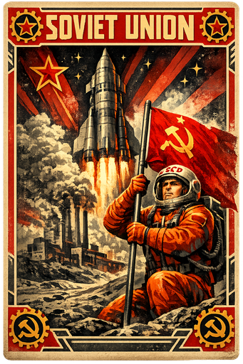 | +40% Resource Extraction |
| **China** | 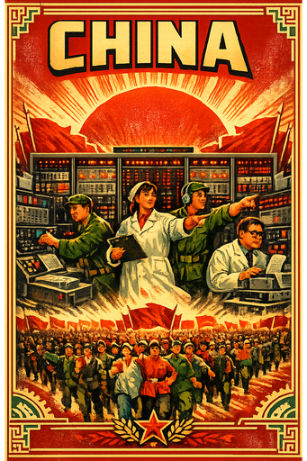 | +50% Population Growth |
| **Africa** | 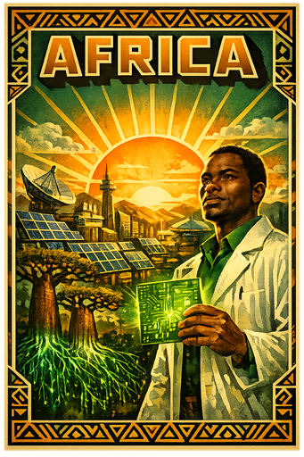 | +60% Solar Potential |
| **South America** | 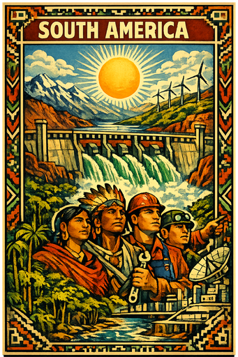 | +25% Renewables |
| **India** | 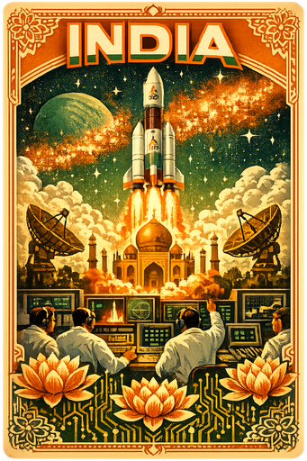 | +40% Labor Force |
| **Oceania** | 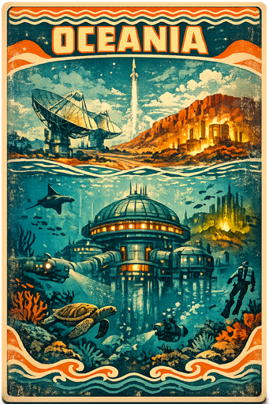 | +15% Uranium, Defensive |

---

## Game Mechanics

The rules live in `src/game/` as plain TypeScript with no React dependency:

| File | Contents |
|------|----------|
| `data.ts` | Continents, buildings, technologies, historical events |
| `mapgen.ts` | Continent tile map generated from the real territory outlines |
| `engine.ts` | Reducer, yearly economy, placement rules, rivals, climate, events, victory and defeat |
| `bot.ts` | Scripted player used by the balance simulator |

Balance is checked headless (continent, mode, strategy, seed):

```bash
node tools/sim/sim.ts eu complete balanced 11
```

Every minigame has a solvability test in `tools/verify-minigames/`:

```bash
node tools/verify-minigames/turing.test.ts
```

---

## Sound Design

Immersive era-specific audio:
- **1960s** — Propeller aircraft, early jet engines
- **1970s-80s** — Jet aircraft, Cold War tension
- **1990s** — Supersonic flight, digital revolution
- **2000s** — Modern jet engines, tech boom
- **2010s+** — Drones, electric aircraft, AI hum
- **Satellite Launch** — Rocket liftoff sound
- **Sputnik Beeps** — Occasional satellite transmission sounds

---

## Tech Stack

| Technology | Purpose |
|------------|---------|
| **React 19** | UI framework with concurrent features |
| **TypeScript** | Type-safe development |
| **Vite 7** | Lightning-fast build tooling |
| **Tailwind CSS v3** | Utility-first styling |
| **shadcn/ui** | Component primitives |
| **Web Audio API** | Procedural sound effects |
| **HTML5 Video** | Cinematic playback |
| **Canvas API** | Particle effects and visualizations |
| **Google Translate** | 30+ language support |

---

## Game Data

- **75** Cinematic Videos
- **71** Card Images (PNG)
- **8** Playable Factions with generated tile maps
- **22** Building Types, 3 levels each
- **30** Technologies in 5 eras
- **30+** Historical decisions + dynamic climate, AI-incident and diplomatic events
- **8** Breakthrough minigames
- **14** National decrees, a two-good industrial economy and a world market
- **15** Achievements, 3 difficulty levels, save slots + autosave
- **4** Game Modes

---

## Credits

**Created by:** Francisco Angulo de Lafuente  
**GitHub:** [@Agnuxo1](https://github.com/Agnuxo1)  
**Built with:** Kimi Agent (AI-assisted development)

**Art Style:** Cold War propaganda poster meets retro-futurism  
**Color Identity:** Phosphor green (#33FF33) on deep black — the glow of the first computer terminals

---

<p align="center">
  <strong>THE RACE TO ASI BEGINS NOW</strong><br>
  <em>"Whoever achieves artificial superintelligence first will determine the fate of humanity."</em>
</p>

<p align="center">
  <a href="https://huggingface.co/spaces/Agnuxo/terra-compute-game">
    
  </a>
</p>
